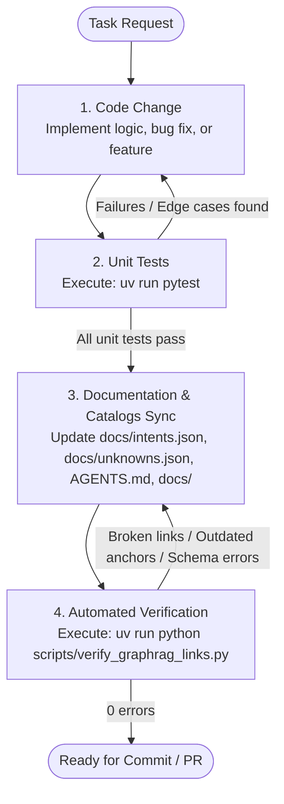

# GraphRAG Intent Linking & Documentation Skill

This skill guides engineers and agents in maintaining bidirectional traceability between Coddy's Python source code and its architectural documentation for GraphRAG indexing, including the active intent registry (`docs/intents.json`) and the unreferenced/disconnected code catalog (`docs/unknowns.json`).

## 1. Intent Mapping Categories & Central Registry (`docs/intents.json`)

Every functional path in Coddy is classified, maintained, and registered in the central intent registry [`docs/intents.json`](../../../docs/intents.json) and mirrored in [`AGENTS.md`](../../../AGENTS.md) under eight formal intent categories:

### Intent 1: CLI Interface (`cli_interface`)
* **Pattern**: `<CLI command> CALLS <handling function/method>`
* **Description**: User-facing command line interface commands and subcommands mapped to their handling Python functions.
* **Target**: Python functions in [`app/coddy/app.py`](../../../app/coddy/app.py) and [`app/coddy/cli/`](../../../app/coddy/cli/).

### Intent 2: Agent Workflow (`agent_workflow`)
* **Pattern**: `<Orchestrating agent> USES <Worker agent>` OR `<DecisionNode / Router> CALLS_IF <Target Node / Branch>`
* **Description**: Orchestrator graph workflow routing, step node transitions, worker agent dispatch invocations, and conditional branching/looping decisions.
* **Target**: Workflow orchestrator, step nodes, decision routers, and agent callbacks in [`app/coddy/agentic/workflows/coding_orchestrate/workflow.py`](../../../app/coddy/agentic/workflows/coding_orchestrate/workflow.py) and step node definitions (`step_*_nodes.py`).

> [!IMPORTANT]
> **Complete Workflow & Graph Decisions Registration**:
> `docs/intents.json` must document the **entire workflow** end-to-end, including all step transitions, worker agent delegations, and every graph decision node.
> - **Decision Nodes & Routers**: Decision functions or router nodes that inspect state and route execution MUST be labeled with `:DecisionNode` and `:Router`.
> - **Conditional Edges (`CALLS_IF`)**: Outgoing edges from decision routers MUST use the predicate `CALLS_IF` and explicitly document the `logical_text` (the plain-language or boolean logic condition) and the associated `route` key.
> - **Associated Coding Pattern**: Graph decisions and loops must be reflected directly in workflow edge definitions using tuple routing maps:
>   ```python
>   (
>       setup_episodic_research_context,
>       coding_researcher,
>       has_remaining_research,   # --> this is a @route / :DecisionNode / :Router
>       {
>           "YES": setup_episodic_research_context, 
>           "NO": (
>               # ...
>           ), 
>       },
>   ),
>   ```
> - **JSON Intent Schema for Decision Nodes**:
>   ```json
>   {
>     "id": "workflow_decision_<node>_<branch>",
>     "type": "agent_workflow",
>     "subject": "<RouterFunctionName>",
>     "predicate": "CALLS_IF",
>     "object": "<TargetNodeOrBranch>",
>     "source_file": "app/coddy/agentic/workflows/coding_orchestrate/<step_file>.py",
>     "line_anchor": "L<start>-L<end>",
>     "symbol": "<RouterFunctionName>",
>     "description": "Decision Router: Routes to <TargetNode> when <condition>.",
>     "details": {
>       "labels": [":DecisionNode", ":Router"],
>       "route": "<route_key>",
>       "logical_text": "<Clear boolean condition or logic text>"
>     }
>   }
>   ```

### Intent 3: Tool Usage (`tool_usage`)
* **Pattern**: `<Worker agent> USES <Tool> CALLS <handling function/method>`
* **Description**: Specialized worker agent tool invocations resolving to internal tool provider handling methods.
* **Target**: Standalone tool functions in [`app/coddy/agentic/tools/graphrag_tools.py`](../../../app/coddy/agentic/tools/graphrag_tools.py).

### Intent 4: Database Operations (`database_operation`)
* **Pattern**: `<function/method> READS/CREATES/UPDATES/DELETES <Database <object>>`
* **Description**: Operations performed on database engines (FalkorDB Cypher graphs, Qdrant vectors, SQLite session state, DuckDB metrics).
* **Target**: [`GraphService`](../../../app/coddy/graphrag/services/graph_service.py) and [`VectorService`](../../../app/coddy/graphrag/services/vector_service.py) in `app/coddy/graphrag/services/`.

### Intent 5: File Input/Output (`file_io`)
* **Pattern**: `<function/method> READS/CREATES/UPDATES/DELETES <file>`
* **Description**: Filesystem input/output operations including GraphRAG commit caches and structured session artifacts.
* **Target**: `.cache/graphrag/*`, `~/.coddy/<session_id>/artifacts/...` (sanitized briefs, research plans, specifications).

### Intent 6: External Services & APIs (`external_api`)
* **Pattern**: `<Caller> CALLS <External Service/API>`
* **Description**: Network and local HTTP service requests targeting LLM inference engines and search endpoints.
* **Target**: `http://localhost:1234/v1/models`, Cloud Gemini API, and `https://html.duckduckgo.com/html/`.

### Intent 7: Callback Dispatch & Dependency Injection (`callback_dispatch`)
* **Pattern**: `<Provider> INJECTS <Callback/Plugin> INTO <Consumer>`
* **Description**: Dynamic dependency injections, ADK plugins, node lifecycle callbacks, and model response handlers.
* **Target**: Callbacks (`load_project_context`, `on_before_*`, `on_after_*`, `on_after_model_*`) and plugins (`MetricsPlugin`) registered in [`CodingOrchestratorWorkflow`](../../../app/coddy/agentic/workflows/coding_orchestrate/workflow.py).

### Intent 8: Artifact Transformation (`artifact_transformation`)
* **Pattern**: `<Mapper> TRANSFORMS <Source Schema> INTO <Target Document>`
* **Description**: Deterministic Pydantic schema mappers converting JSON data models into human-readable Markdown documents (Rule R2).
* **Target**: Mappers in [`app/coddy/agentic/mappers/`](../../../app/coddy/agentic/mappers/).

---

## 2. Disconnected Components & Unknowns Catalog (`docs/unknowns.json`)

To prevent code bloat, misleading documentation, and dead code accumulation, Coddy maintains a formal registry of unreferenced, disconnected, or placeholder code components in [`docs/unknowns.json`](../../../docs/unknowns.json).

### 2.1 Unknown Categories
Every recorded entry must specify one of the following diagnostic categories:
- `disconnected_callback`: Callbacks or UI hooks defined but not wired into workflow nodes or event lifecycles (e.g. `terminal_approval_gate`, `terminal_ask_user`).
- `unwired_cli_flag`: CLI arguments or flags parsed by Typer but never passed into active workflow execution (e.g. `auto_approve`).
- `unused_config`: Pydantic settings models or config classes defined but bypassed in favor of hardcoded constants (e.g. `CoddyConfig`).
- `uninvoked_preflight`: Pre-flight verification routines implemented but omitted from command entrypoints (e.g. `verify_models`).
- `unreferenced_helper`: Helper utilities defined but unreferenced by any runtime caller (e.g. `find_agents_markdown`).
- `unused_tool`: Agent tools implemented with decorators but unassigned to any active worker agent instance (e.g. `GraphRAGTools`).
- `unwired_schema`: Downstream schemas and mappers defined but whose generating workflow step nodes are placeholders (e.g. `Specification`, `Plan`).
- `unimplemented_storage`: Storage path helpers or database targets documented but unintegrated in runtime dependencies (e.g. `get_memory_db_path`).
- `stub_step_node`: Workflow pipeline step placeholders returning static or unvalidated mock data.

### 2.2 Unknown Item Schema
Each unknown entry in `docs/unknowns.json` requires:
```json
{
  "id": "unknown_<unique_identifier>",
  "symbol": "<symbol_or_function_name>",
  "source_file": "app/coddy/<relative_path>.py",
  "line_anchor": "L<start>-L<end>",
  "category": "<category_from_above>",
  "description": "Clear explanation of why this symbol is considered disconnected or uncalled.",
  "impact": "Concrete runtime or architectural impact of the disconnection.",
  "recommendation": "Prescriptive action: wire up into active pipeline, refactor, or delete as dead code."
}
```

### 2.3 Unknowns Lifecycle Rules
- **Rule U1 (Add on Discovery)**: When an engineer or agent discovers unreferenced functions, uncalled checks, dead parameters, or introduces a temporary stub, an entry **must** be appended to `docs/unknowns.json`.
- **Rule U2 (Promote to Intent on Wiring)**: When a disconnected component is wired into active workflow execution, it **must** be removed from `docs/unknowns.json` and registered as an active intent in `docs/intents.json`.
- **Rule U3 (Purge on Deletion)**: When a dead code component is removed from the codebase, its corresponding entry in `docs/unknowns.json` **must** be deleted.

---

## 3. Formal Development & Maintenance Workflow

To prevent documentation drift and ensure GraphRAG index integrity, all agents and engineers **must** follow the **Code -> Test -> Document** lifecycle:



### Step 1: Code Change
* Modify or implement the Python code in `app/coddy/`.
* Adhere strictly to typing annotations, error handling, and strict Pydantic schemas (`extra="forbid"`).

### Step 2: Unit Testing (Iteration Loop)
* Run the full unit test suite:
  ```bash
  uv run pytest
  ```
* **Loop**: If any test fails, diagnose the root cause, return to Step 1, and re-run tests until all test cases pass with zero failures.

### Step 3: Documentation & Catalogs Sync
Once unit tests pass, update all corresponding documentation artifacts:
1. **`docs/intents.json`**:
   * Add any new active intents or update existing records (`line_anchor`, `description`, `symbol`, `details`).
   * Verify that `docs/intents.json` reflects all active execution paths.
2. **`docs/unknowns.json`**:
   * Add new entries for any newly created stubs, unwired flags, or discovered disconnected components.
   * If an existing unknown was wired into active execution, move it to `docs/intents.json`.
   * If a dead component was deleted, remove it from `docs/unknowns.json`.
3. **`AGENTS.md`**:
   * Update Intent tables in Section 4 (CLI commands, external services, dependency injections, tools).
   * Update line anchors to match exact code ranges.
   * Maintain Section 4.6 (Disconnected Components & Unknowns Catalog) to mirror `docs/unknowns.json`.
4. **`docs/agent_workflow.md`**:
   * Update flowcharts, sequence diagrams, agent definitions, or tool lists if agent topology was modified.
5. **`docs/graphrag_ingestion_pipeline.md`**:
   * Update dual-store alignment logic, node/edge tables, or chunking parameters if ingestion was modified.

### Step 4: Automated Verification
* Execute the automated verification script:
  ```bash
  uv run python scripts/verify_graphrag_links.py
  ```
* This script validates that:
  - All file links and symbol anchors in `AGENTS.md` and skills exist and match the code.
  - All skill YAML frontmatters and links are valid.
  - All intents in `docs/intents.json` reference valid files, symbols, and line boundaries.
  - All unknowns in `docs/unknowns.json` reference valid files, symbols, line boundaries, and adhere to schema.
* If any discrepancy is reported, adjust the documentation and re-verify until 100% clean.

---

## 4. GraphRAG Markdown Formatting Standards

To ensure optimal extraction by GraphRAG parsers:
1. **Explicit Entity References**: Always format references as `[EntityName](path/to/file.py#Lstart-Lend)`.
2. **Anchor Stability**: When modifying code files, review line numbers in [`AGENTS.md`](../../../AGENTS.md), [`docs/agent_workflow.md`](../../../docs/agent_workflow.md), [`docs/graphrag_ingestion_pipeline.md`](../../../docs/graphrag_ingestion_pipeline.md), [`docs/intents.json`](../../../docs/intents.json), and [`docs/unknowns.json`](../../../docs/unknowns.json), updating line anchors if code shifts.
3. **Triples & Diagrams**: Maintain Mermaid top-down flowcharts and message flow sequence diagrams in architecture documents to visually express data and control flow topologies.

---

## 5. Maintenance Protocol Checklist

Whenever you implement a new feature or modify an existing one, execute this checklist to prevent documentation drift:

- [ ] **Phase 1 & 2: Code & Unit Tests**:
  - Implement changes in `app/coddy/`.
  - Run `uv run pytest` until all tests pass without errors.
- [ ] **Phase 3: Central Intents Registry (`docs/intents.json`) & Unknowns Catalog (`docs/unknowns.json`)**:
  - Register any new active intents (CLI, workflow, tool, database, file I/O, external API, callback, or mapper).
  - Update `line_anchor`, `description`, `symbol`, and `details` for any modified functions.
  - Audit unreferenced code or stubs in `docs/unknowns.json`: promote wired components to `docs/intents.json`, remove purged dead code, or register new unknowns.
- [ ] **CLI Changes**: If adding or updating a Typer command/option in `app/coddy/cli/`:
  - Update Intent 1 in `AGENTS.md` and `docs/intents.json`.
  - Update `docs/cli_reference.md`.
  - Verify alignment with `docs/agent_workflow.md`.
- [ ] **API / Service Changes**: If adding an HTTP request, external process call, or database/file storage operation:
  - Update Intent 2, 4, 5, 6 in `AGENTS.md` and `docs/intents.json`.
  - Update `app/coddy/helpers/pre_flight_checks.py` if endpoints change.
- [ ] **Agent Workflow & Multi-Agent Logic Changes**: If modifying workflow topologies, worker agents, approval gates, mappers, or execution order:
  - Update Intent 2 & 7 in `AGENTS.md` and `docs/intents.json`. Ensure `docs/intents.json` documents the **entire workflow**, including all step nodes, worker agent invocations, decision routers labeled `:DecisionNode` and `:Router`, and all conditional branching edges labeled `CALLS_IF` with documented `logical_text`.
  - Reflect decision routing directly in workflow definitions using tuple routing maps:
    ```python
    (
        setup_episodic_research_context,
        coding_researcher,
        has_remaining_research,   # --> this is a @route / :DecisionNode / :Router
        {
            "YES": setup_episodic_research_context, 
            "NO": (
                # ...
            ), 
        },
    ),
    ```
  - Update `docs/agent_workflow.md`:
    - Synchronize the top-down Mermaid flowchart (`flowchart TD`) and sequence diagram (`sequenceDiagram`) with exact method references.
    - Synchronize agent definitions, roles, models, and instruction links.
    - Synchronize tool intents and handling function references.
  - Update `.agents/skills/rtd-agent-development/SKILL.md` if agent patterns change.
- [ ] **Ingestion Pipeline, Graph & Vector Logic Changes**: If modifying AST parsing (`CodeASTExtractor`), documentation chunking (`DoclingChunker`), sparse embeddings (`get_sparse_embeddings`), node/edge schema (`GraphNode`, `GraphEdge`), or caching (`save_graphrag_cache`):
  - Update `docs/graphrag_ingestion_pipeline.md`:
    - Synchronize the top-down Mermaid flowchart and sequence diagram.
    - Document any new node labels, edge relationship types, and cross-linking triggers.
    - Document sparse vector collection schemas and fallback behaviors.
  - Update Intent 4 & 5 in `docs/intents.json`.
- [ ] **Phase 4: Automated Validation**: Run the verification script:
  ```bash
  uv run python scripts/verify_graphrag_links.py
  ```
  Ensure all file links, symbols, line anchors, `docs/intents.json` entries, and `docs/unknowns.json` entries resolve cleanly without errors.
