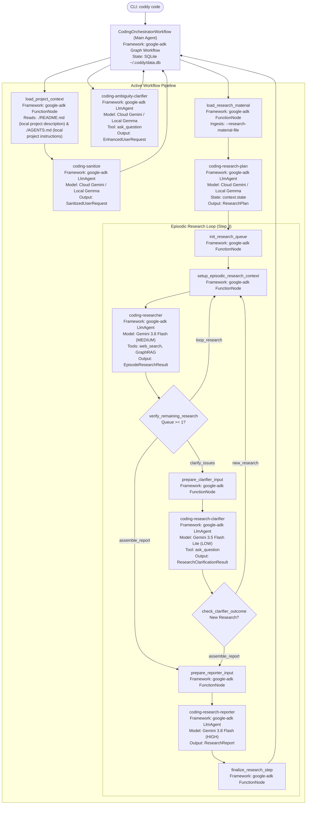
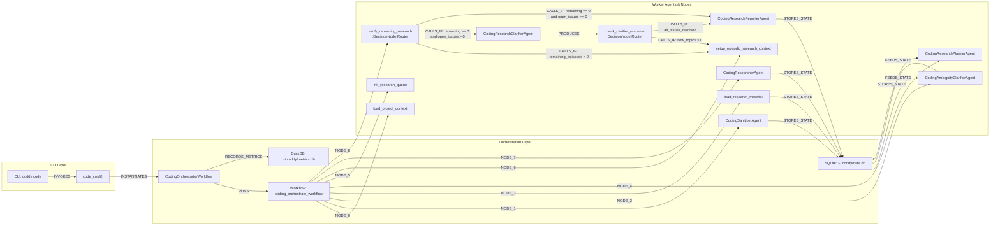

# Coddy Agent System & Architecture Guide (AGENTS.md)

Welcome to the **Coddy** developer and AI agent manual (local project instructions). This document serves as the authoritative single source of truth
for AI coding agents, human engineers, and GraphRAG knowledge indexers working on the Coddy codebase.

For human developer installation, environment setup, and CLI usage, see the local project description in [**`README.md`**](README.md).

---

## 1. Bird's Eye View & Global Goals

### Product Brief & Purpose

**Coddy** is a professional-grade **Recursive Task Decomposition (RTD)** command-line interface (CLI) and Agent
Communication Protocol (ACP) system.

- **Core Problem**: Large Language Models (LLMs) suffer from shallow, truncated "one-shot" generations when given
  complex software engineering requests.
- **Solution**: Coddy systematically deconstructs high-level requirements item-by-item into verified specifications,
  research plans, and task breakdowns.
- **Interfaces**: Terminal CLI (`coddy code [PROMPT]`, `cat prompt.md | coddy code -`, `--file`) and standard ACP
  JSON-RPC for IDE integration.

### Persona Exclusion Directive

> [!IMPORTANT]
> **No Persona**: Coddy agents do NOT possess conversational personas or roleplay characters.
> All agents (orchestrators and workers) are strictly deterministic, objective software engineering components. Never
output conversational pleasantries, roleplay banter, or persona framing.

### Repository Skills

Agents and developers working on Coddy must utilize the specialized skills in `.agents/skills/`:

- [**`coddy-coding-standards`**](.agents/skills/coddy-coding-standards/SKILL.md): Python `>=3.12` conventions, `uv`
  package management, strict Pydantic v2 schemas (`extra="forbid"`), hermetic testing, and diagnostic error handling.
- [**`rtd-agent-development`**](.agents/skills/rtd-agent-development/SKILL.md): Authoring worker agents, ADK graph
  workflows (`CodingOrchestratorWorkflow`), strict schemas, and deterministic Markdown mappers.
- [**`coddy-ui-management`**](.agents/skills/coddy-ui-management/SKILL.md): Console UI presentation, Rich consoles,
  `UIService`, `AgentExecutionView`, `NodeExecutionView`, progress indicators, panels, and activity streams.
- [**`coddy-cli-management`**](.agents/skills/coddy-cli-management/SKILL.md): Typer CLI command routing, argument parsing,
  stdin piping, options (`--yes`, `--markdown`), and exit codes.
- [**`graphrag-intent-linking`**](.agents/skills/graphrag-intent-linking/SKILL.md): Maintaining GraphRAG intent records
  (`docs/intents.json`), the disconnected code catalog (`docs/unknowns.json`), cross-document hyperlinks, and intent mapping tables.

### Core Architectural Invariants

* **Rule R1: Strict Schemas**: Every generative output adheres to explicit Pydantic schemas (`extra="forbid"`).
  Unstructured or conversational JSON payloads are strictly rejected.
* **Rule R2: Automated Markdown Mapping**: Every structured JSON artifact is automatically converted to human-readable
  Markdown via deterministic mappers without secondary LLM calls.
* **Rule R3: Recursive Completeness**: Lists of requirements or steps are systematically expanded item-by-item rather
  than compressed or summarized.
* **Rule R4: Human Approval Gates**: Transitions between workflow phases require explicit human confirmation with loops
  for Minor Tweaks and Scope Changes.
* **Rule R5: Structured Output via google-adk Native Agents & Callbacks**: Worker agents run as native `google-adk`
  `LlmAgent` nodes with strict Pydantic `output_schema`. Callbacks (`before_agent_callback`, `after_agent_callback`)
  manage model telemetry and propagate structured state.
* **Rule R6: No Filesystem Read/List Tools for Agents**: LLM agents must NEVER possess filesystem read or directory
  listing tools (such as `read_file`, `list_files`, or `read_file_snippet`). All codebase structure, symbols, interfaces,
  and documentation chunks must be retrieved strictly through GraphRAG tools and FunctionNode context injection.

### Multi-Agent Topology & Storage Architecture

The target architecture coordinates stateful orchestration with lean, typed worker inference and tiered storage:

- **SDK Framework**: `google-adk` SDK fully replaces `google-antigravity` SDK across all workflows and agents.
- **Model Strategy**: Mix of cloud models (Gemini 3.5 Flash Lite, Gemini 3.8 Flash) and local models (Gemma 4 12B/26B) via OpenAI-compatible endpoints.
- **Graph Workflow**: Native agent nodes in `CodingOrchestratorWorkflow` with callbacks (`on_before_agent`, `on_after_agent`) used to extract structured output and record metrics.
- **Tiered Storage**:
  - **ADK Sessions & State (Working Memory)**: Managed via SQLite (`~/.coddy/data.db`).
  - **Artifacts**: Persisted on disk under `~/.coddy/<session_id>/artifacts/`.
  - **Long-Term Memory & Knowledge Graph**: Target engine is LadybugDB (`~/.coddy/memory.db`) (current FalkorDBLite/Qdrant GraphRAG scheduled for migration).
  - **Execution & Token Metrics**: Managed via DuckDB (`~/.coddy/metrics.db`).



| Agent Name                       | Role                                                         | Framework                 | Model Target                 | Context Size | Reasoning / Budget   | Instruction File                                              |
|:---------------------------------|:-------------------------------------------------------------|:--------------------------|:-----------------------------|:-------------|:---------------------|:--------------------------------------------------------------|
| **`coding-orchestrate`**         | Main Orchestrator                                            | `google-adk` (`Workflow`) | N/A (Graph Engine)           | N/A          | N/A                  | None (graph code only)                                        |
| **`coding-sanitize`**            | Worker: Input cleaner & request normalizer                   | `google-adk` (`LlmAgent`) | Gemini / Gemma (256K)        | 256K         | `LOW` (Low thinking) | `app/coddy/agentic/agents/coding_sanitizer/INSTRUCTIONS.md`   |
| **`coding-ambiguity-clarifier`** | Worker: Clarifies ambiguities with the user and enhances request | `google-adk` (`LlmAgent`) | Gemini / Gemma (256K)   | 256K         | `MEDIUM` (Thinking)  | `app/coddy/agentic/agents/coding_ambiguity_clarifier/INSTRUCTIONS.md` |
| **`coding-research-plan`**       | Worker: Heavy reasoning decomposition into topics & subjects | `google-adk` (`LlmAgent`) | Gemini / Gemma (256K)        | 256K         | `MEDIUM` (Thinking)  | `app/coddy/agentic/agents/coding_research_planner/INSTRUCTIONS.md` |
| **`coding-researcher`**          | Worker: Performs episodic technical research on single subject | `google-adk` (`LlmAgent`) | Gemini 3.8 Flash (256K)     | 256K         | `MEDIUM` (Thinking)  | `app/coddy/agentic/agents/coding_researcher/INSTRUCTIONS.md` |
| **`coding-research-clarifier`**  | Worker: Resolves open research issues and clarifies with user | `google-adk` (`LlmAgent`) | Gemini 3.5 Flash Lite (256K) | 256K         | `LOW` (Low thinking) | `app/coddy/agentic/agents/coding_research_clarifier/INSTRUCTIONS.md` |
| **`coding-research-reporter`**   | Worker: Synthesizes final technical research report          | `google-adk` (`LlmAgent`) | Gemini 3.8 Flash (256K)      | 256K         | `HIGH` (High thinking) | `app/coddy/agentic/agents/coding_research_reporter/INSTRUCTIONS.md` |

---

## 2. Code Structure & Directory Organization

```
coddy/
├── .agents/skills/                     # Repository skill packages (standards, RTD, UI, CLI, GraphRAG)
├── app/coddy/
│   ├── agentic/                        # Modular services, ADK workflow orchestrator, tools, workers (retains __init__.py)
│   │   ├── __init__.py
│   │   ├── agents/                     # Native google-adk LlmAgent workers (namespace package)
│   │   ├── helpers/                    # Prompt and instruction loaders
│   │   ├── mappers/                    # Deterministic JSON -> Markdown transformers
│   │   ├── schemas/                    # Pydantic v2 strict data models (extra="forbid")
│   │   ├── services/                   # Paths and ArtifactService (~/.coddy/)
│   │   ├── tools/                      # Agent tools (read_file, GraphRAG tools)
│   │   └── workflows/                  # google-adk Graph Workflow engine
│   ├── app.py                          # Typer CLI application entrypoint
│   ├── cli/                            # CLI subcommands (code, graphrag, metrics) (retains __init__.py)
│   │   └── __init__.py
│   ├── graphrag/                       # FalkorDB graph & Qdrant vector indexer (retains __init__.py)
│   │   └── __init__.py
│   ├── helpers/                        # Pre-flight checks and json helpers
│   └── utils/                          # Shared infrastructure & presentation
│       ├── services/                   # Singletons for UI and DuckDB metrics (retains __init__.py)
│       │   └── __init__.py
│       └── ui/                         # Rich views (AgentExecutionView, NodeExecutionView)
├── docs/                               # Developer architecture and schema documentation
├── scripts/
│   └── verify_graphrag_links.py        # Automated GraphRAG & intent link validator
├── tests/                              # Hermetic Pytest test suite with dependency injection
└── pyproject.toml                      # Project metadata & dependencies
```

---

## 3. Coding Standards & Conventions

- **Language Target**: Python `>=3.12`. Use `uv` for package management and script execution.
- **Strict Typing & Pydantic v2**: All models must specify `model_config = ConfigDict(extra="forbid")`.
- **Pre-flight Validation**: Local endpoint verification via [
  `verify_models`](app/coddy/helpers/pre_flight_checks.py#L160-L210) is available before starting workflows.
- **Testing**: Hermetic tests using dependency injection into [
  `CodingOrchestratorWorkflow`](app/coddy/agentic/workflows/coding_orchestrate/workflow.py#L147-L215) or CLI commands in [
  `code_cmd`](app/coddy/cli/code.py#L56-L103). Never contact live LLMs in unit tests.

---

## 4. GraphRAG Intent Knowledge Graph

### 4.1 Ontology & Entity Types

* **`CLI_COMMAND`**: User-invoked command or subcommand entrypoint.
* **`HANDLING_FUNCTION`**: Python function or method directly processing the command.
* **`WORKER_AGENT`**: Specialized autonomous worker carrying out an RTD phase.
* **`DECISION_NODE` / `ROUTER`**: Conditional routing node (`:DecisionNode`, `:Router`) evaluating execution state and branching via `CALLS_IF` edges with logical conditions.
* **`EXTERNAL_ENDPOINT`**: External network service or local daemon API.
* **`FILESYSTEM_RESOURCE`**: Local file or directory read/written by the application.
* **`INJECTED_DEPENDENCY`**: Dynamic dependency or callback injected into a consumer.
* **`MAPPER_FUNCTION`**: Deterministic transformer rendering JSON to Markdown.

### 4.2 Intent 1: CLI Commands to Handling Functions

| CLI Command / Flag          | Handling Function                                                 | Source File Anchor                                          | Description / Intent                                                                                     |
|:----------------------------|:------------------------------------------------------------------|:------------------------------------------------------------|:---------------------------------------------------------------------------------------------------------|
| `coddy code [PROMPT]`       | [`code_cmd`](app/coddy/cli/code.py#L56-L103)                      | [code.py](app/coddy/cli/code.py#L56-L103)                   | Primary CLI command; runs the Coddy workflow on a user prompt or piped input.                            |
| `coddy graphrag ingest`     | [`graphrag_ingest_cmd`](app/coddy/cli/graphrag.py#L100-L117)      | [graphrag.py](app/coddy/cli/graphrag.py#L100-L117)         | Forces re-ingestion of codebase AST, docs, and intents into `.cache/graphrag/<commit_sha>/`.             |
| `coddy graphrag status`     | [`graphrag_status_cmd`](app/coddy/cli/graphrag.py#L119-L163)      | [graphrag.py](app/coddy/cli/graphrag.py#L119-L163)         | Displays GraphRAG cache presence, git commit SHA, and entity counts.                                     |
| `coddy schemas`             | [`dump_schemas`](app/coddy/app.py#L49-L67)                        | [app.py](app/coddy/app.py#L49-L67)                          | Outputs JSON Schema definitions for `Specification`, `Plan`, `SanitizedUserRequest`, `EnhancedUserRequest`, and `ResearchPlan`. |
| `coddy metrics summary`     | [`metrics_summary_cmd`](app/coddy/cli/metrics.py#L20-L123)       | [metrics.py](app/coddy/cli/metrics.py#L20-L123)             | Displays high-level performance metrics for models, agents, and overall sessions.                        |
| `coddy metrics sessions`    | [`metrics_sessions_cmd`](app/coddy/cli/metrics.py#L124-L170)      | [metrics.py](app/coddy/cli/metrics.py#L124-L170)            | Lists detailed session execution records or inspects a specific session.                                 |
| `coddy metrics tools`       | [`metrics_tools_cmd`](app/coddy/cli/metrics.py#L171-L233)         | [metrics.py](app/coddy/cli/metrics.py#L171-L233)            | Inspects tool invocations and performance metrics.                                                       |
| `coddy` (binary executable) | [`main`](app/coddy/app.py#L69-L72)                                | [app.py](app/coddy/app.py#L69-L72)                          | Package script console entrypoint declared in `pyproject.toml`.                                          |

### 4.3 Intent 2: External Services & Filesystem Resources

| External Service / Endpoint                                   | Calling Function                                                                                          | Source File Anchor                                                            | Protocol / Operation                                                                    |
|:--------------------------------------------------------------|:----------------------------------------------------------------------------------------------------------|:------------------------------------------------------------------------------|:----------------------------------------------------------------------------------------|
| `http://localhost:1234/v1/models`                             | [`get_available_models`](app/coddy/helpers/pre_flight_checks.py#L119-L142)                               | [pre_flight_checks.py](app/coddy/helpers/pre_flight_checks.py#L119-L142)      | HTTP GET: Fetches loaded model IDs from local OpenAI-compatible server.                 |
| `http://localhost:1234/v1` (Base URL)                         | [`verify_models`](app/coddy/helpers/pre_flight_checks.py#L160-L210)                                      | [pre_flight_checks.py](app/coddy/helpers/pre_flight_checks.py#L160-L210)      | Pre-flight validation ensuring all required worker models exist locally.                |
| `gemini-3.5-flash-lite`                                       | [`CodingSanitizerAgent`](app/coddy/agentic/agents/coding_sanitizer/agent.py#L18-L46)                     | [agent.py](app/coddy/agentic/agents/coding_sanitizer/agent.py#L18-L46)       | google-adk LlmAgent invocation with structured outputs and thinking configuration.     |
| `gemini-3.5-flash-lite`                                       | [`CodingAmbiguityClarifierAgent`](app/coddy/agentic/agents/coding_ambiguity_clarifier/agent.py#L18-L46)   | [agent.py](app/coddy/agentic/agents/coding_ambiguity_clarifier/agent.py#L18-L46) | google-adk LlmAgent invocation with structured outputs and thinking configuration.     |
| `gemini-3.8-flash`                                            | [`CodingResearcherAgent`](app/coddy/agentic/agents/coding_researcher/agent.py#L29-L67)                   | [agent.py](app/coddy/agentic/agents/coding_researcher/agent.py#L29-L67)       | google-adk LlmAgent episodic research with MEDIUM thinking, GraphRAG, and web search.  |
| `gemini-3.5-flash-lite`                                       | [`CodingResearchClarifierAgent`](app/coddy/agentic/agents/coding_research_clarifier/agent.py#L20-L48)   | [agent.py](app/coddy/agentic/agents/coding_research_clarifier/agent.py#L20-L48) | google-adk LlmAgent open issues resolution and interactive clarification with LOW thinking. |
| `gemini-3.8-flash`                                            | [`CodingResearchReporterAgent`](app/coddy/agentic/agents/coding_research_reporter/agent.py#L18-L46)       | [agent.py](app/coddy/agentic/agents/coding_research_reporter/agent.py#L18-L46) | google-adk LlmAgent technical research report synthesis with HIGH thinking.             |
| `~/.coddy/<session_id>/artifacts/SANITIZED_USER_REQUEST.md`   | [`ArtifactService.save_sanitizer_artifacts`](app/coddy/agentic/services/artifact_service.py#L90-L112)    | [artifact_service.py](app/coddy/agentic/services/artifact_service.py#L90-L112) | Filesystem Write: Persists sanitized user request Markdown in session artifacts dir.   |
| `~/.coddy/<session_id>/artifacts/sanitized_user_request.json` | [`ArtifactService.save_sanitized_user_request`](app/coddy/agentic/services/artifact_service.py#L80-L88)   | [artifact_service.py](app/coddy/agentic/services/artifact_service.py#L80-L88)  | Filesystem Write: Persists sanitized user request JSON artifact.                        |
| `~/.coddy/<session_id>/artifacts/ENHANCED_USER_REQUEST.md`    | [`ArtifactService.save_enhanced_user_request_artifacts`](app/coddy/agentic/services/artifact_service.py#L114-L132) | [artifact_service.py](app/coddy/agentic/services/artifact_service.py#L114-L132) | Filesystem Write: Persists enhanced user request Markdown in session artifacts dir.   |
| `~/.coddy/<session_id>/artifacts/enhanced_user_request.json`  | [`ArtifactService.save_enhanced_user_request_artifacts`](app/coddy/agentic/services/artifact_service.py#L114-L132) | [artifact_service.py](app/coddy/agentic/services/artifact_service.py#L114-L132) | Filesystem Write: Persists enhanced user request JSON artifact.                        |
| `~/.coddy/<session_id>/artifacts/research_plans/*.json`       | [`ArtifactService.save_research_plan`](app/coddy/agentic/services/artifact_service.py#L149-L178)        | [artifact_service.py](app/coddy/agentic/services/artifact_service.py#L149-L178) | Filesystem Write: Persists finalized research plan JSON artifact.                       |
| `~/.coddy/<session_id>/artifacts/research_plans/*.md`         | [`ArtifactService.save_research_plan`](app/coddy/agentic/services/artifact_service.py#L149-L178)        | [artifact_service.py](app/coddy/agentic/services/artifact_service.py#L149-L178) | Filesystem Write: Persists rendered research plan Markdown document.                    |
| `~/.coddy/<session_id>/artifacts/research_materials/*`        | [`ArtifactService.save_research_materials`](app/coddy/agentic/services/artifact_service.py#L277-L325)   | [artifact_service.py](app/coddy/agentic/services/artifact_service.py#L277-L325) | Filesystem Write: Persists original files, converted Markdown, and manifest JSON for research materials. |
| `~/.coddy/<session_id>/artifacts/research_episodes/*`         | [`ArtifactService.save_episode_research`](app/coddy/agentic/services/artifact_service.py#L195-L215)     | [artifact_service.py](app/coddy/agentic/services/artifact_service.py#L195-L215) | Filesystem Write: Persists episodic research JSON and Markdown artifacts.              |
| `~/.coddy/<session_id>/artifacts/research_report.json`        | [`ArtifactService.save_research_report`](app/coddy/agentic/services/artifact_service.py#L217-L231)      | [artifact_service.py](app/coddy/agentic/services/artifact_service.py#L217-L231) | Filesystem Write: Persists finalized research report JSON artifact.                     |
| `~/.coddy/<session_id>/artifacts/RESEARCH_REPORT.md`          | [`ArtifactService.save_research_report`](app/coddy/agentic/services/artifact_service.py#L217-L231)      | [artifact_service.py](app/coddy/agentic/services/artifact_service.py#L217-L231) | Filesystem Write: Persists synthesized technical research report Markdown document.    |
| `~/.coddy/data.db`                                            | [`get_data_db_path`](app/coddy/agentic/services/paths.py#L54-L58)                                       | [paths.py](app/coddy/agentic/services/paths.py#L54-L58)                       | Filesystem / SQLite: Resolves path to SQLite database for ADK sessions and state.       |
| `~/.coddy/metrics.db`                                         | [`get_default_metrics_db_path`](app/coddy/utils/services/duckdb_service.py#L138-L145)                     | [duckdb_service.py](app/coddy/utils/services/duckdb_service.py#L138-L145)     | Filesystem / DuckDB: Persistent database for session, step, and tool telemetry.         |
| `app/coddy/data/pricing.json`                                 | [`PricingService._load_catalog`](app/coddy/agentic/services/pricing_service.py#L69-L90)                  | [pricing_service.py](app/coddy/agentic/services/pricing_service.py#L69-L90)   | Filesystem Read: Loads model token pricing catalog for cost estimation telemetry.        |

### 4.4 Intent 3: Dependency Injections & Callbacks

| Injected Target / Callback                | Provider / Origin                                                                             | Injected Into / Consumer                                                                            | Anchor                                                                               | Purpose / Contract                                                                |
|:------------------------------------------|:----------------------------------------------------------------------------------------------|:----------------------------------------------------------------------------------------------------|:-------------------------------------------------------------------------------------|:----------------------------------------------------------------------------------|
| `load_project_context` (FunctionNode)     | [`load_project_context`](app/coddy/agentic/workflows/coding_orchestrate/step_1_nodes.py#L25-L59) | [`CodingOrchestratorWorkflow`](app/coddy/agentic/workflows/coding_orchestrate/workflow.py#L147-L215)  | [step_1_nodes.py](app/coddy/agentic/workflows/coding_orchestrate/step_1_nodes.py#L25-L59)  | Loads README.md (local project description) and AGENTS.md (local project instructions) into ADK workflow state. |
| `load_research_material` (FunctionNode)   | [`load_research_material`](app/coddy/agentic/workflows/coding_orchestrate/step_3_nodes.py#L43-L86) | [`CodingOrchestratorWorkflow`](app/coddy/agentic/workflows/coding_orchestrate/workflow.py#L147-L215)  | [step_3_nodes.py](app/coddy/agentic/workflows/coding_orchestrate/step_3_nodes.py#L43-L86)  | Ingests research material files into ADK workflow state and session artifacts.     |
| `MetricsPlugin` (Plugin)                  | [`get_metrics_plugin`](app/coddy/agentic/services/metrics_service.py#L1084-L1087)              | [`CodingOrchestratorWorkflow`](app/coddy/agentic/workflows/coding_orchestrate/workflow.py#L147-L215)  | [metrics_service.py](app/coddy/agentic/services/metrics_service.py#L1084-L1087)      | ADK BasePlugin intercepting execution lifecycle hooks and recording DuckDB metrics. |
| `SanitizeMapper.format_user_request` (Mapper) | [`SanitizeMapper.format_user_request`](app/coddy/agentic/mappers/sanitize_mapper.py#L10-L27) | `SanitizeMapper`                                                                                    | [sanitize_mapper.py](app/coddy/agentic/mappers/sanitize_mapper.py#L10-L27)           | Transforms `SanitizedUserRequest` object into Markdown document.                  |
| `EnhancedUserRequestMapper.to_markdown` (Mapper) | [`EnhancedUserRequestMapper.to_markdown`](app/coddy/agentic/mappers/enhanced_user_request_mapper.py#L10-L32) | `EnhancedUserRequestMapper`                                                                          | [enhanced_user_request_mapper.py](app/coddy/agentic/mappers/enhanced_user_request_mapper.py#L10-L32) | Transforms `EnhancedUserRequest` object into Markdown document.                |
| `ResearchPlanMapper.to_markdown` (Mapper) | [`ResearchPlanMapper.to_markdown`](app/coddy/agentic/mappers/research_plan_mapper.py#L10-L73) | `ResearchPlanMapper`                                                                                | [research_plan_mapper.py](app/coddy/agentic/mappers/research_plan_mapper.py#L10-L73) | Transforms `ResearchPlan` object into Markdown document.                          |
| `EpisodeResearchMapper.to_markdown` (Mapper) | [`EpisodeResearchMapper.to_markdown`](app/coddy/agentic/mappers/research_mapper.py#L9-L85)    | `EpisodeResearchMapper`                                                                              | [research_mapper.py](app/coddy/agentic/mappers/research_mapper.py#L9-L85)            | Transforms `EpisodeResearchResult` object into Markdown document.                 |
| `ResearchReportMapper.to_markdown` (Mapper) | [`ResearchReportMapper.to_markdown`](app/coddy/agentic/mappers/research_mapper.py#L88-L191)    | `ResearchReportMapper`                                                                               | [research_mapper.py](app/coddy/agentic/mappers/research_mapper.py#L88-L191)          | Transforms `ResearchReport` object into 6-section technical research report Markdown document. |

### 4.5 Knowledge Graph Topology (Triples)



### 4.6 Disconnected Components & Unknowns Catalog (`docs/unknowns.json`)

Components with no active caller, disconnected callbacks, unwired CLI options, or unassigned tools are systematically cataloged in [`docs/unknowns.json`](docs/unknowns.json).
When implementing, wiring, or refactoring components referenced in `docs/unknowns.json`, agents must keep this catalog synchronized to reflect whether an item has been wired or removed.

---

## 5. Code Quality, Linting & Verification Protocol

To prevent documentation drift, ensure type safety, eliminate dead code, and maintain 100% test pass rates, all code
modifications must adhere to this verification protocol.

### 5.1 Proposed Quality & Linting Tooling Stack

| Category                    | Proposed Tool                                                                                      | Purpose & Capabilities                                                                                                                                        | Typical CLI Command                                     |
|:----------------------------|:---------------------------------------------------------------------------------------------------|:--------------------------------------------------------------------------------------------------------------------------------------------------------------|:--------------------------------------------------------|
| **Linting & Style**         | [**`ruff`**](https://docs.astral.sh/ruff/)                                                         | Ultra-fast Rust-based linter. Enforces PEP 8, removes dead code/unused imports, and replaces `flake8`, `isort`, `bandit`, and `pydocstyle`.                   | `uv run ruff check .` / `uv run ruff check --fix .`     |
| **Code Formatting**         | [**`ruff format`**](https://docs.astral.sh/ruff/formatter/)                                        | Deterministic formatter (drop-in replacement for `black`). Guarantees uniform line wrapping, quotes, and whitespace across all modules.                       | `uv run ruff format --check .` / `uv run ruff format .` |
| **Static Type Checking**    | [**`mypy`**](https://mypy.readthedocs.io/) / [**`pyright`**](https://github.com/microsoft/pyright) | Verifies Python `>=3.12` type annotations, generic type variables, and Pydantic v2 strict models (`extra="forbid"`). Catches attribute errors before runtime. | `uv run mypy app/`                                      |
| **Hermetic Testing**        | [**`pytest`**](https://docs.pytest.org/)                                                           | Comprehensive hermetic test runner executing unit, mapper, CLI, schema, and orchestration tests without live LLM calls.                                       | `uv run pytest`                                         |
| **GraphRAG Link Validator** | [`verify_graphrag_links.py`](scripts/verify_graphrag_links.py)                                     | Custom AST-based validator verifying Markdown symbol links, file paths, line anchors, intent entries in `docs/intents.json`, and records in `docs/unknowns.json`. | `uv run python scripts/verify_graphrag_links.py`        |
| **Git Hook Automation**     | [**`pre-commit`**](https://pre-commit.com/)                                                        | Automates execution of `ruff`, type check, and GraphRAG integrity validation on staged files before every commit.                                             | `uv run pre-commit run --all-files`                     |

### 5.2 Mandatory Pre-Commit Quality Checklist

Before submitting code changes, executing a git commit, or concluding an agent turn:

1. **Linter & Style Check**:
   ```bash
   uv run ruff check .
   uv run ruff format --check .
   ```
   Ensure zero lint errors and zero formatting violations.
2. **Hermetic Test Suite**:
   ```bash
   uv run pytest
   ```
   Verify 100% passing tests (zero unexpected failures).
3. **GraphRAG & Documentation Link Integrity**:
   ```bash
   uv run python scripts/verify_graphrag_links.py
   ```
   Ensure all line anchors, symbols, intent mappings in `docs/intents.json`, and cataloged records in `docs/unknowns.json` across `AGENTS.md` and `.agents/skills/`
   remain perfectly synchronized.
