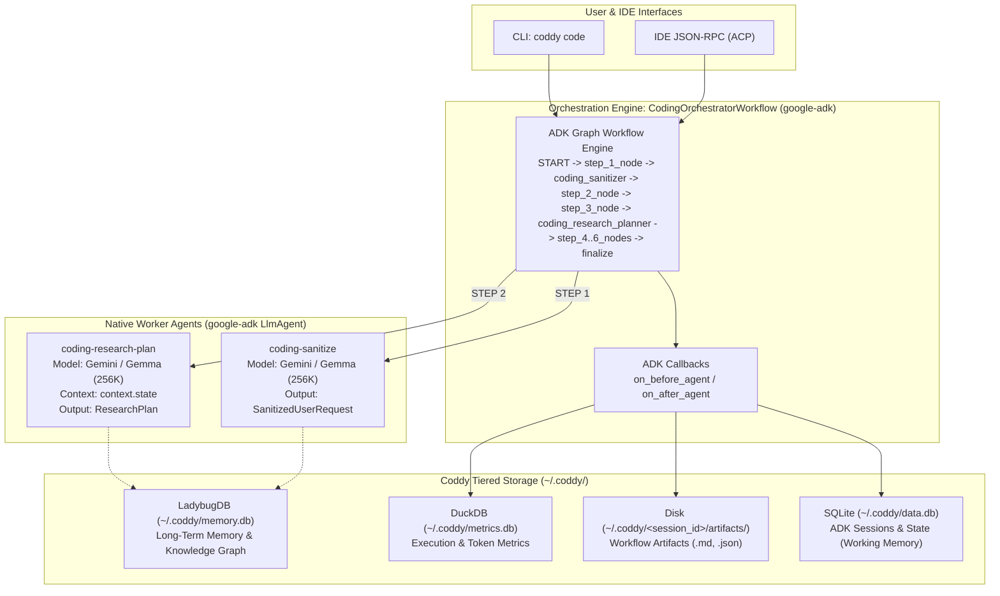

# Coddy

> **Professional-grade Recursive Task Decomposition (RTD) CLI & ACP Tool**

---

## 1. Project Overview

**Coddy** is an agentic engineering tool that bridges high-level business requirements and granular, step-by-step code implementations. Large Language Models often generate shallow, truncated outputs when tackling non-trivial software tasks. Coddy solves this via **Recursive Task Decomposition (RTD)**: systematically expanding requirements item-by-item into verified specifications, research plans, and execution tasks.

This document serves as the local project description. For local project instructions, system invariants, and architectural guidelines, see [**`AGENTS.md`**](AGENTS.md).

---

## 2. Getting Started Guide

### Prerequisites
1. **Python**: `>= 3.12` installed.
2. **Package Manager**: [`uv`](https://docs.astral.sh/uv/) installed:
   ```bash
   curl -LsSf https://astral.sh/uv/install.sh | sh
   ```
3. **Model Endpoints**: Supports a mix of cloud Gemini models (via Google GenAI SDK) and local models (e.g. Gemma via LM Studio / Ollama / vLLM at `http://localhost:1234/v1`).

### Setting Up the Environment

Clone the repository and install dependencies:

```bash
git clone https://github.com/gpfister/coddy.git
cd coddy
uv sync

# Configure environment and credentials
cp .env.dist .env
```

Configure your credentials in `.env` for either:
- **Google AI Studio**: set `GOOGLE_GENAI_USE_VERTEXAI=FALSE` and `GOOGLE_API_KEY=your_key`.
- **Vertex AI**: set `GOOGLE_APPLICATION_CREDENTIALS=~/.config/gcloud/...` and `GOOGLE_GENAI_USE_VERTEXAI=true`.

### Typical Application Usage

```bash
# 1. Run workflow directly with a prompt
uv run coddy code "Build a distributed rate-limiting middleware with Redis"

# 2. Pipe input from stdin (ideal for shell scripts and prompt files)
cat requirements.md | uv run coddy code -

# 3. Read prompt from a file
uv run coddy code --file prompt.md

# 4. Inspect GraphRAG knowledge graph and vector cache status
uv run coddy graphrag status

# 5. Force re-ingestion of codebase AST and documentation into GraphRAG
uv run coddy graphrag ingest

# 6. Inspect DuckDB execution and token metrics
uv run coddy metrics summary
uv run coddy metrics sessions
uv run coddy metrics tools

# 7. View supported JSON schemas
uv run coddy schemas

# 8. Run unit test suite
uv run pytest
```

---

## 3. High-Level Architecture

Coddy coordinates **stateful orchestration** (managing persistence, session context, tracking, and UI) with **lean worker agents** (purely functional inference units):



---

## 4. Documentation

Detailed design documents, schemas, and subsystem references are located in [`docs/`](./docs):
- [Architecture & Design](./docs/architecture.md)
- [Recursive Task Decomposition (RTD)](./docs/recursive_task_decomposition.md)
- [Agent Workflow Guide](./docs/agent_workflow.md)
- [Metrics & Telemetry Architecture](./docs/metrics_and_telemetry.md)
- [Terminal UI Architecture](./docs/ui_architecture.md)
- [GraphRAG Ingestion Pipeline](./docs/graphrag_ingestion_pipeline.md)
- [Specification Schema Reference](./docs/specification_schema.md)
- [Plan Schema Reference](./docs/plan_schema.md)
- [Agent Communication Protocol (ACP)](./docs/acp_protocol.md)
- [CLI Reference](./docs/cli_reference.md)
- [Central Intents Registry (`intents.json`)](./docs/intents.json)
