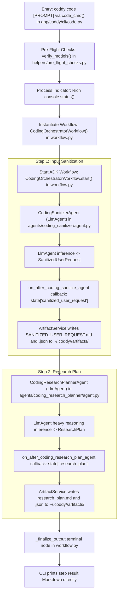
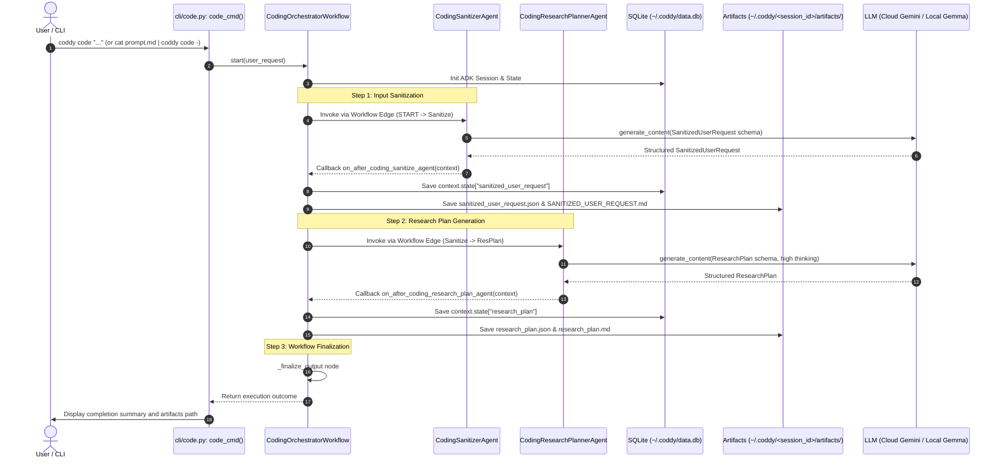

# Agent Workflow & Multi-Agent Architecture

This document specifies the multi-agent orchestration architecture, topological execution graphs, agent definitions,
communication protocols, and tool intents implemented in Coddy.

---

## 1. Architectural Philosophy & Invariants

Coddy solves the problem of shallow, truncated "one-shot" LLM generations by enforcing **Recursive Task Decomposition (
RTD)**. The system transitions from high-level, ambiguous user prompts down to atomic, verified engineering plans
through specialized worker agents:

* **Rule R1: Strict Schemas**: Every generative payload conforms to strict Pydantic v2 schemas (`extra="forbid"`).
* **Rule R2: Automated Markdown Mapping**: Machine-readable JSON artifacts are deterministically transformed into
  human-readable Markdown via dedicated mappers.
* **Rule R3: Recursive Completeness**: Requirements and execution steps are systematically expanded item-by-item rather
  than summarized.
* **Rule R4: Human Approval Gates**: Transitions between Specification, Plan, and Implementation require explicit human
  confirmation with loops for *Minor Tweaks* and *Scope Changes*.
* **Rule R5: Structured Output via Google ADK & Session State**: Worker agents enforce Pydantic output schemas via
  `output_schema` in `google.adk.agents.LlmAgent`. Invocations share session state via ADK's native `Session` and `State`
  engine, persisted in SQLite (`~/.coddy/data.db`). Markdown artifacts are generated from structured outputs exclusively
  using deterministic schema mappers.

---

## 2. Top-Down Flowchart: Agent Workflow

The workflow is modeled as a Google ADK Graph Workflow built in [
`CodingOrchestratorWorkflow`](../app/coddy/agentic/workflows/coding_orchestrate/workflow.py#L155-L266).

State and session management are handled natively via `google-adk` session and state services backed by SQLite
(`~/.coddy/data.db`). Artifacts are persisted on disk under `~/.coddy/<session_id>/artifacts/`. The workflow graph
executes `START -> step_1_node -> _coding_sanitize_agent -> step_2_node -> step_3_node -> _coding_research_plan_agent -> step_4_node -> step_5_node -> step_6_node -> _finalize_output`, with downstream workers
staged for step-by-step reintroduction.

---

## 3. Message Flow Sequence Diagram

The interaction sequence between user, orchestrator, specialized workers, and model runtime:

---

## 4. Agent Catalog & Definitions

Each agent is defined as an independent `LlmAgent` within `google-adk`, equipped with dedicated system prompts, model
configurations, schemas, and deterministic mappers.

### 4.1 Orchestrator Agent (`coding-orchestrate`)

* **Class Definition**: [
  `CodingOrchestratorWorkflow`](../app/coddy/agentic/workflows/coding_orchestrate/workflow.py#L116-L177)
* **Framework**: `google-adk` (`Workflow`, `BaseAgent`)
* **Role**: Primary graph workflow coordinator. Validates models on startup, chains native agent nodes (`START ->
  CodingSanitizerAgent -> CodingResearchPlannerAgent -> _finalize_output`), handles telemetry and token usage via
  `on_after_agent` callbacks, and persists execution state in SQLite (`~/.coddy/data.db`).
* **Injected Dependencies**:
    - `session_service`: [`SessionService`](../app/coddy/agentic/services/session_service.py) for SQLite state persistence.
    - `metrics_service`: [`MetricsService`](../app/coddy/agentic/services/metrics_service.py) for DuckDB metrics logging.
    - `metrics_plugin`: [`MetricsPlugin`](../app/coddy/agentic/services/metrics_service.py) registering ADK execution hooks.

### 4.2 Sanitization Agent (`coding-sanitize`)

* **Class Definition**: [
  `CodingSanitizerAgent`](../app/coddy/agentic/agents/coding_sanitizer/agent.py#L18-L44)
* **Instruction Manual**: [
  `app/coddy/agentic/agents/coding_sanitizer/INSTRUCTIONS.md`](../app/coddy/agentic/agents/coding_sanitizer/INSTRUCTIONS.md)
* **Model ID**: Cloud `gemini-3.5-flash-lite` or Local `google/gemma-4-12b` (Context: 262,144 tokens / 256K, Thinking Level: LOW)
* **Target Schema**: [
  `SanitizedUserRequest`](../app/coddy/agentic/schemas/sanitize.py#L32-L48)
* **Mapper**: [
  `SanitizeMapper.format_user_request`](../app/coddy/agentic/mappers/sanitize_mapper.py#L10-L27)
* **Role**: Normalizes raw user request, removes conversational noise, identifies ambiguous terms, and captures optional
  local project instructions and local project description into structured outputs.

### 4.3 Research Plan Agent (`coding-research-plan`)

* **Class Definition**: [
  `CodingResearchPlannerAgent`](../app/coddy/agentic/agents/coding_research_planner/agent.py#L17-L43)
* **Instruction Manual**: [
  `app/coddy/agentic/agents/coding_research_planner/INSTRUCTIONS.md`](../app/coddy/agentic/agents/coding_research_planner/INSTRUCTIONS.md)
* **Model ID**: Cloud `gemini-3.8-flash` or Local `google/gemma-4-26b-a4b-qat` (Context: 262,144 tokens / 256K, Thinking Level: MEDIUM)
* **Target Schema**: [
  `ResearchPlan`](../app/coddy/agentic/schemas/research_plan.py#L30-L40)
* **Mapper**: [
  `ResearchPlanMapper.to_markdown`](../app/coddy/agentic/mappers/research_plan_mapper.py#L10-L70)
* **Role**: Ingests sanitized user request, employs heavy reasoning to break requirements down into structured topics
  and research subjects.

---

## 5. Agent Tools Registered as GraphRAG Intents

Every standalone tool method in [
`app/coddy/agentic/tools/graphrag_tools.py`](../app/coddy/agentic/tools/graphrag_tools.py)
is classified as an explicit architectural intent linking the tool declaration to its execution engine:

| Tool Intent Name         | Handling Function / Method                                                                                               | Source Anchor                                                                                                | Backing Engine / Target                                                                                        | Invoked By                     | Description & Contract                                                                                      |
|:-------------------------|:-------------------------------------------------------------------------------------------------------------------------|:-------------------------------------------------------------------------------------------------------------|:---------------------------------------------------------------------------------------------------------------|:-------------------------------|:------------------------------------------------------------------------------------------------------------|
| `search_facts`           | [`search_facts`](../app/coddy/agentic/tools/graphrag_tools.py#L48-L84)                                                   | [graphrag_tools.py#L48-L84](../app/coddy/agentic/tools/graphrag_tools.py#L48-L84)                            | [`VectorService.search_facts`](../app/coddy/graphrag/services/vector_service.py#L309-L352)                     | Worker Agents / GraphRAG Tools | Queries architectural invariants & patterns via FastEmbed BM25/BM42 and Reciprocal Rank Fusion.             |
| `search_documents`       | [`search_documents`](../app/coddy/agentic/tools/graphrag_tools.py#L86-L120)                                             | [graphrag_tools.py#L86-L120](../app/coddy/agentic/tools/graphrag_tools.py#L86-L120)                          | [`VectorService.search_chunks`](../app/coddy/graphrag/services/vector_service.py#L276-L307)                    | Worker Agents / GraphRAG Tools | Queries Markdown documentation chunks (`DocChunk` collection) with BM25/BM42 dual scoring.                  |
| `execute_cypher`         | [`execute_cypher`](../app/coddy/agentic/tools/graphrag_tools.py#L122-L140)                                               | [graphrag_tools.py#L122-L140](../app/coddy/agentic/tools/graphrag_tools.py#L122-L140)                        | [`FalkorDBService.query`](../app/coddy/utils/services/falkordb_service.py)                                     | LLM tool dispatch              | Runs arbitrary Cypher queries against the embedded FalkorDB graph store (future LadybugDB target).          |
| `get_code_entity`        | [`get_code_entity`](../app/coddy/agentic/tools/graphrag_tools.py#L142-L215)                                              | [graphrag_tools.py#L142-L215](../app/coddy/agentic/tools/graphrag_tools.py#L142-L215)                        | [`FalkorDBService.query`](../app/coddy/utils/services/falkordb_service.py)                                     | LLM tool dispatch              | Retrieves AST properties, line ranges, and inbound/outbound relationships for a class, function, or method. |
| `get_call_hierarchy`     | [`get_call_hierarchy`](../app/coddy/agentic/tools/graphrag_tools.py#L217-L265)                                           | [graphrag_tools.py#L217-L265](../app/coddy/agentic/tools/graphrag_tools.py#L217-L265)                        | [`FalkorDBService.query`](../app/coddy/utils/services/falkordb_service.py)                                     | LLM tool dispatch              | Traverses the call graph in `incoming`, `outgoing`, or `both` directions up to specified depth.             |
| `list_intents`           | [`list_intents`](../app/coddy/agentic/tools/graphrag_tools.py#L267-L292)                                                 | [graphrag_tools.py#L267-L292](../app/coddy/agentic/tools/graphrag_tools.py#L267-L292)                        | [`FalkorDBService.query`](../app/coddy/utils/services/falkordb_service.py)                                     | LLM tool dispatch              | Lists system architectural intents and invariant rules registered in the graph.                             |
| `find_dead_code`         | [`find_dead_code`](../app/coddy/agentic/tools/graphrag_tools.py#L294-L337)                                               | [graphrag_tools.py#L294-L337](../app/coddy/agentic/tools/graphrag_tools.py#L294-L337)                        | [`FalkorDBService.query`](../app/coddy/utils/services/falkordb_service.py)                                     | LLM tool dispatch              | Identifies functions with no incoming `CALLS` relations, filtering out CLI entrypoints and magic methods.   |
| `trace_dead_code_impact` | [`trace_dead_code_impact`](../app/coddy/agentic/tools/graphrag_tools.py#L339-L364)                                       | [graphrag_tools.py#L339-L364](../app/coddy/agentic/tools/graphrag_tools.py#L339-L364)                        | [`FalkorDBService.query`](../app/coddy/utils/services/falkordb_service.py)                                     | LLM tool dispatch              | Determines whether removing a symbol impacts any downstream callees or references.                          |
| `list_files`             | [`list_files`](../app/coddy/agentic/tools/graphrag_tools.py#L366-L390)                                                   | [graphrag_tools.py#L366-L390](../app/coddy/agentic/tools/graphrag_tools.py#L366-L390)                        | Local Filesystem (`Path.rglob`)                                                                                | Worker Agents / GraphRAG Tools | Returns repository files matching an optional glob pattern, ignoring virtualenvs and build caches.          |
| `read_file_snippet`      | [`read_file_snippet`](../app/coddy/agentic/tools/graphrag_tools.py#L392-L434)                                            | [graphrag_tools.py#L392-L434](../app/coddy/agentic/tools/graphrag_tools.py#L392-L434)                        | Local Filesystem (`Path.read_text`)                                                                            | LLM tool dispatch              | Reads a specific line range (`start_line` to `end_line`) from a repository source file.                     |
| `web_search`             | [`web_search`](../app/coddy/agentic/tools/graphrag_tools.py#L436-L486)                                                   | [graphrag_tools.py#L436-L486](../app/coddy/agentic/tools/graphrag_tools.py#L436-L486)                        | DuckDuckGo HTTP search fallback                                                                                | Worker Agents / GraphRAG Tools | Performs web search for undocumented external APIs, frameworks, or libraries.                               |
| `execute_tool_call`      | [`GraphRAGTools.execute_tool_call`](../app/coddy/agentic/tools/graphrag_tools.py#L543-L576)                             | [graphrag_tools.py#L543-L576](../app/coddy/agentic/tools/graphrag_tools.py#L543-L576)                        | Tool Dispatch Router                                                                                           | LLM Tool Calling Engine        | Decodes named tool invocations with JSON arguments and returns stringified JSON results.                    |
