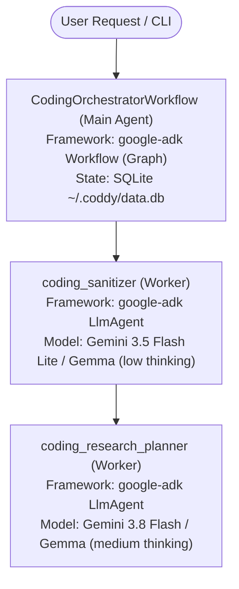
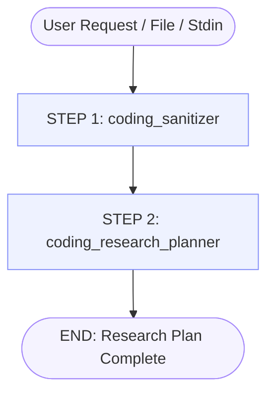

# Coddy Architecture

## 1. Architectural Philosophy
Coddy eliminates the core pathology of current LLM-assisted software engineering: **shallow, truncated one-shot outputs**.

Standard LLM workflows attempt to generate entire systems or plans in a single generative pass. This invariably leads to vague bullet points, missing edge cases, and incomplete technical specifications. 

Coddy enforces **Recursive Task Decomposition (RTD)**:
1. High-level requests are broken into explicit, validated lists.
2. The agentic runtime expands each item into deep, production-ready technical detail.
3. Every step enforces strict JSON schema contracts (`extra="forbid"`).
4. Automated Mappers continuously translate structured machine representations into human-readable Markdown.
5. Human approval gates govern transitions between phases.

---

## 2. Agent Ecosystem & Model Allocation Strategy

Coddy's architecture coordinates a **Main Graph Workflow Orchestrator** and specialized **Native Worker Agents**:

- **SDK Framework**: `google-adk` SDK fully replaces `google-antigravity` SDK across all workflows and agents.
- **Model Strategy**: Mix of cloud models (Gemini 3.5 Flash Lite, Gemini 3.8 Flash) and local models (Gemma 4 12B/26B) via OpenAI-compatible endpoints.
- **Graph Workflow**: Native agent nodes in `CodingOrchestratorWorkflow` with callbacks (`on_before_agent`, `on_after_agent`) used to integrate models and record telemetry.
- **Tiered Storage Architecture**:
  - **ADK Sessions & State (Working Memory)**: Managed via SQLite (`~/.coddy/data.db`).
  - **Artifacts**: Persisted on disk under `~/.coddy/<session_id>/artifacts/`.
  - **Long-Term Memory & Knowledge Graph**: Target engine is LadybugDB (`~/.coddy/memory.db`) (current FalkorDBLite/Qdrant GraphRAG scheduled for migration).
  - **Execution & Token Metrics**: Managed via DuckDB (`~/.coddy/metrics.db`).



### Agent Roles and Model Configuration Matrix

| Agent Name | Type | Framework | Model Target | Thinking Config | Purpose |
| :--- | :--- | :--- | :--- | :--- | :--- |
| **`coding-orchestrate`** | **Main Orchestrator** | `google-adk` (`Workflow`) | Graph Engine | Native Graph Engine | Coordinates ADK graph workflow, manages sessions and state via callbacks |
| **`coding-sanitize`** | Worker Agent | `google-adk` (`LlmAgent`) | `gemini-3.5-flash-lite` / `google/gemma-4-12b` | `ThinkingLevel.LOW` | Ingests raw input, removes noise, outputs `SanitizedUserRequest` schema |
| **`coding-research-plan`** | Worker Agent | `google-adk` (`LlmAgent`) | `gemini-3.8-flash` / `google/gemma-4-26b-a4b-qat` | `ThinkingLevel.MEDIUM` | Decomposes sanitized user request into topics and research subjects (`ResearchPlan` schema) |

---

## 3. Core Workflow Graph



---

## 4. Directory Layout

The codebase organizes runtime agents and instructions inside `app/coddy`:

```text
app/coddy/
├── app.py                      # Typer CLI application entrypoint (main, schemas)
├── cli/                        # CLI subcommands (retains __init__.py)
│   ├── __init__.py
│   ├── code.py                 # coddy code [PROMPT] implementation & human gates
│   ├── graphrag.py             # coddy graphrag ingest / status commands
│   └── metrics.py              # coddy metrics summary / sessions / tools commands
├── agentic/                    # Core agentic runtime, ADK workflow & workers (retains __init__.py)
│   ├── __init__.py
│   ├── agents/                 # Native google-adk LlmAgent workers (namespace package)
│   │   ├── coding_sanitizer/   # STEP 1 Worker: Sanitization (agent.py, INSTRUCTIONS.md)
│   │   └── coding_research_planner/ # STEP 2 Worker: Research Planning (agent.py, INSTRUCTIONS.md)
│   ├── helpers/                # Prompt & instruction loading utilities
│   ├── mappers/                # Rule R2: Deterministic JSON -> Markdown mappers
│   ├── schemas/                # Rule R1: Strict Pydantic Models (extra='forbid')
│   ├── services/               # Paths resolution & ArtifactService (~/.coddy/)
│   ├── tools/                  # Agent tools (read_file, GraphRAG tools)
│   └── workflows/              # google-adk Graph Workflow engine
│       └── coding_orchestrate/ # CodingOrchestratorWorkflow definition & runner
├── graphrag/                   # FalkorDB & Qdrant vector indexer (retains __init__.py)
│   └── __init__.py
├── helpers/                    # Pre-flight checks and json helpers
└── utils/                      # Shared infrastructure & presentation
    ├── services/               # UI and Database service singletons (retains __init__.py)
    │   └── __init__.py
    └── ui/                     # Rich views and formatters (agent_view, node_view)
```
