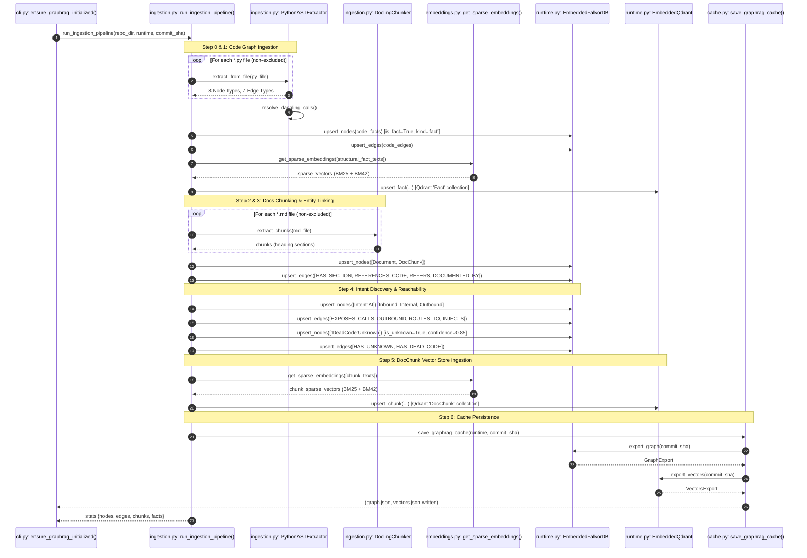
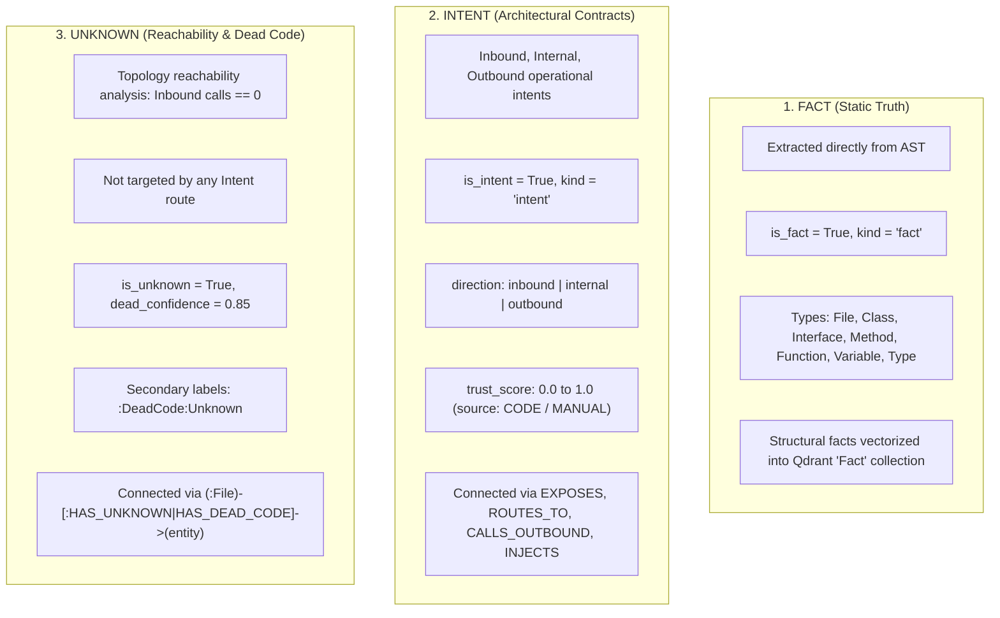

# GraphRAG Ingestion Pipeline Architecture

This document provides the definitive reference for Coddy's in-memory GraphRAG ingestion pipeline. The architecture mirrors 100% of the extraction ontology, pipeline stages (Steps 0 through 6), node taxonomy, relationship topology, and FACT / INTENT / UNKNOWN classification lifecycle established in [`py-graphrag-oskey-io`](file:///Users/gpfister/Development/Projects/oskey-io/AI/py-graphrag-oskey-io).

---

## 1. Pipeline Overview & Lifecycle

Coddy's GraphRAG subsystem transforms a local repository into an in-memory knowledge graph (powered by embedded FalkorDB) and an in-memory sparse vector store (powered by embedded Qdrant). It provides code intelligence, architectural invariant checking, and context discovery for worker agents.

### 1.1 Ingestion Trigger & Caching Strategy
Ingestion is initiated either explicitly via `coddy graphrag ingest` ([`graphrag_ingest_cmd`](file:///Users/gpfister/Development/Projects/gpfister/coddy/coddy/app/coddy/cli.py#L463-L478)) or lazily on application startup via [`ensure_graphrag_initialized`](file:///Users/gpfister/Development/Projects/gpfister/coddy/coddy/app/coddy/cli.py#L110-L200).

```
Repository Working Tree
       │
       ▼
git rev-parse HEAD ─────────► commit_sha
       │
       ▼
git status --porcelain ─────► is_git_dirty
       │
       ▼
Check .cache/graphrag/<commit_sha>/{graph.json, vectors.json}
       │
       ├─► [HIT & Clean Tree] ──► Fast restore: load_graphrag_cache()
       └─► [MISS or Dirty]    ──► Full execution: run_ingestion_pipeline()
```

1. **Commit Pinning**: The cache key is derived from [`get_git_commit_sha`](file:///Users/gpfister/Development/Projects/gpfister/coddy/coddy/app/coddy/graphrag/cache.py#L14-L30).
2. **Working Tree Dirtiness**: [`is_git_dirty`](file:///Users/gpfister/Development/Projects/gpfister/coddy/coddy/app/coddy/graphrag/cache.py#L32-L46) detects uncommitted changes and prompts the user or triggers re-ingestion.
3. **Cache Persistence**: Serialized via [`save_graphrag_cache`](file:///Users/gpfister/Development/Projects/gpfister/coddy/coddy/app/coddy/graphrag/cache.py#L58-L77) into `.cache/graphrag/<commit_sha>/graph.json` and `.cache/graphrag/<commit_sha>/vectors.json`.

---

## 2. Ingestion Pipeline Stages (Steps 0–6)

The pipeline executes seven sequential stages defined in [`run_ingestion_pipeline`](file:///Users/gpfister/Development/Projects/gpfister/coddy/coddy/app/coddy/graphrag/ingestion.py#L880-L1300):

| Stage | Name | Key Function / Class | Output & Invariant |
| :--- | :--- | :--- | :--- |
| **Step 0** | Repository Context & Pre-Flight Check | [`run_ingestion_pipeline`](file:///Users/gpfister/Development/Projects/gpfister/coddy/coddy/app/coddy/graphrag/ingestion.py#L890-L895) | Validates repo root, extracts git commit SHA, inspects cache availability. |
| **Step 1** | Code Graph Ingestion & Deep AST Extraction | [`PythonASTExtractor`](file:///Users/gpfister/Development/Projects/gpfister/coddy/coddy/app/coddy/graphrag/ingestion.py#L165-L875) | Parses Python ASTs into 8 code fact node types and 7 relationship types. Vectorizes structural facts into Qdrant `Fact` collection. |
| **Step 2** | Docling Document Chunking | [`DoclingChunker`](file:///Users/gpfister/Development/Projects/gpfister/coddy/coddy/app/coddy/graphrag/ingestion.py#L940-L1015) | Chunks Markdown docs by `#`, `##`, `###` headings into `DocChunk` nodes and creates root `Document` nodes with `HAS_SECTION`. |
| **Step 3** | Cross-Modal Entity Linking | Step 3 in [`run_ingestion_pipeline`](file:///Users/gpfister/Development/Projects/gpfister/coddy/coddy/app/coddy/graphrag/ingestion.py#L1020-L1090) | Discovers backtick code identifiers, file links, and Markdown symbol mentions in chunks; builds `REFERENCES_CODE`, `REFERS`, and `DOCUMENTED_BY` edges. |
| **Step 4** | Intent Discovery, Graph Enrichment & Reachability | Step 4 in [`run_ingestion_pipeline`](file:///Users/gpfister/Development/Projects/gpfister/coddy/coddy/app/coddy/graphrag/ingestion.py#L1095-L1278) | Maps Inbound, Internal, and Outbound intents with `direction`, `category`, and trust score. Connects `EXPOSES`, `CALLS`, `CALLS_OUTBOUND`, `ROUTES_TO`, `INJECTS`, `TRIGGERS`. Performs reachability analysis to tag uncalled entities with `:DeadCode:Unknown`. |
| **Step 5** | RAG Ingestion into Vector Store | Step 5 in [`run_ingestion_pipeline`](file:///Users/gpfister/Development/Projects/gpfister/coddy/coddy/app/coddy/graphrag/ingestion.py#L1280-L1292) | Generates BM25 and BM42 sparse vectors via [`get_sparse_embeddings`](file:///Users/gpfister/Development/Projects/gpfister/coddy/coddy/app/coddy/graphrag/embeddings.py#L56-L80) and upserts chunks into Qdrant `DocChunk` collection. |
| **Step 6** | Cache Persistence & Verification | [`save_graphrag_cache`](file:///Users/gpfister/Development/Projects/gpfister/coddy/coddy/app/coddy/graphrag/cache.py#L58-L77) | Exports graph to `graph.json` and sparse vectors to `vectors.json` in `.cache/graphrag/<commit_sha>/`. |

---

## 3. Top-Down Flowchart

```mermaid
flowchart TD
    CLI["CLI: coddy graphrag ingest or ensure_graphrag_initialized()"] --> STEP0["Step 0: Repo Context & Pre-Flight Check"]
    
    STEP0 --> STEP1["Step 1: PythonASTExtractor Deep AST Parsing"]
    subgraph S1 ["Step 1: AST Extraction & Fact Vectorization"]
        STEP1 --> PARSE["ast.parse() across all non-excluded *.py files"]
        PARSE --> EXTRACT_NODES["Extract 8 Fact Node Types:<br/>File, Class, Interface, Method,<br/>ClassParameter, Function, Variable, Type"]
        PARSE --> EXTRACT_EDGES["Extract 7 Code Relationships:<br/>DEFINES, INHERITS, IMPLEMENTS,<br/>DECLARES, HAS_TYPE, USES_TYPE, CALLS"]
        EXTRACT_EDGES --> DANGLING["Two-Pass resolve_dangling_calls()"]
        DANGLING --> UPSERT_FALKOR_FACTS["Upsert Code Facts to FalkorDB (is_fact=True, kind='fact')"]
        UPSERT_FALKOR_FACTS --> VEC_FACTS["Vectorize Structural Facts (function, class, method, file, interface, type)<br/>via synthesize_fact_content() into Qdrant 'Fact'"]
    end

    VEC_FACTS --> STEP2["Step 2: Docling Markdown Chunking"]
    subgraph S2 ["Step 2 & 3: Docs, Linking & Intent Enrichment"]
        STEP2 --> EXTRACT_CHUNKS["DoclingChunker: Header split (#, ##, ###)"]
        EXTRACT_CHUNKS --> DOC_NODES["Upsert Document & DocChunk:Documentation:DocSection nodes"]
        DOC_NODES --> HAS_SEC["Create (:Document)-[:HAS_SECTION]->(:DocChunk)"]
        HAS_SEC --> STEP3["Step 3: Cross-Modal Entity Linking"]
        STEP3 --> MENTION_SCAN["Extract mentions: `code`, [link](path), qualified names"]
        MENTION_SCAN --> CROSS_EDGES["Create REFERENCES_CODE, REFERS, DOCUMENTED_BY edges"]
        CROSS_EDGES --> STEP4["Step 4: Intent Discovery & Reachability Analysis"]
        STEP4 --> INTENTS["Discover Inbound, Internal, Outbound Intents"]
        INTENTS --> INTENT_EDGES["Create EXPOSES, CALLS, CALLS_OUTBOUND, ROUTES_TO, INJECTS, TRIGGERS"]
        INTENT_EDGES --> REACHABILITY["Reachability / Dead Code Scan:<br/>Entities with 0 inbound calls and no intent route"]
        REACHABILITY --> DEAD_TAG["Tag with :DeadCode:Unknown, is_unknown=True<br/>Link (:File)-[:HAS_UNKNOWN|HAS_DEAD_CODE]->(entity)"]
    end

    DEAD_TAG --> STEP5["Step 5: Vector Ingestion (DocChunk)"]
    subgraph S5 ["Step 5 & 6: Vector Store & Cache Serialization"]
        STEP5 --> SPARSE_CHUNKS["get_sparse_embeddings(chunk_texts)<br/>BM25 & BM42 sparse representations"]
        SPARSE_CHUNKS --> QDRANT_CHUNKS["Upsert into Qdrant 'DocChunk' collection"]
        QDRANT_CHUNKS --> STEP6["Step 6: Cache Persistence"]
        STEP6 --> SAVE_CACHE["save_graphrag_cache()"]
        SAVE_CACHE --> EXPORT_FALKOR["export_graph() -> .cache/graphrag/<sha>/graph.json"]
        SAVE_CACHE --> EXPORT_QDRANT["export_vectors() -> .cache/graphrag/<sha>/vectors.json"]
    end

    EXPORT_QDRANT --> RETURN_STATS["Return counts: nodes, edges, chunks, facts"]
```



---

## 4. Message Flow Sequence Diagram



---

## 5. Mirrored Taxonomy: Node Types, Labels & Properties

Every node extracted into FalkorDB conforms strictly to the ontology mirrored from `py-graphrag-oskey-io`:

| Node Primary Type | Secondary / Applied Labels | ID Format (`id`) | Key Properties | Extraction Logic & Purpose |
| :--- | :--- | :--- | :--- | :--- |
| `File` | `:File:Code:Fact` | `<rel_path>` e.g. `app/coddy/cli.py` | `path`, `source_file`, `is_fact=True`, `kind="fact"` | Represents a concrete source file in the repository. |
| `Class` | `:Class:Code:Fact` | `<rel_path>::<class_name>` | `name`, `clean_name`, `qualified_name`, `signature`, `docstring`, `start_line`, `end_line`, `is_fact=True` | Extracted from `ast.ClassDef` nodes. |
| `Interface` | `:Interface:Code:Fact` | `<rel_path>::<class_name>` | `name`, `clean_name`, `qualified_name`, `interface_type="PROTOCOL"\|"ABC"`, `is_fact=True` | Extracted from classes inheriting `typing.Protocol` or `abc.ABC`. |
| `Method` | `:Method:Code:Fact` | `<rel_path>::<class_name>.<method_name>()` | `name`, `label` (`.name()`), `clean_name`, `qualified_name`, `signature`, `method_type="METHOD"\|"CONSTRUCTOR"\|"DECONSTRUCTOR"`, `is_static`, `visibility="PUBLIC"\|"PRIVATE"\|"PROTECTED"`, `is_fact=True` | Extracted from `ast.FunctionDef` inside class definitions. |
| `ClassParameter` | `:ClassParameter:Code:Fact` | `<rel_path>::<class_name>::<param_name>` | `name`, `clean_name`, `qualified_name`, `type_annotation`, `is_static`, `visibility`, `is_fact=True` | Extracted from class-level annotated attributes and variable assignments. |
| `Function` | `:Function:Code:Fact` | `<rel_path>::<function_name>()` | `name`, `label` (`name()`), `clean_name`, `qualified_name`, `signature`, `docstring`, `visibility`, `start_line`, `end_line`, `is_fact=True` | Extracted from module-level `ast.FunctionDef` or `ast.AsyncFunctionDef`. |
| `Variable` | `:Variable:Code:Fact` | `<callable_id>::<var_name>` | `name`, `clean_name`, `type_annotation`, `is_parameter=True\|False`, `scope="param"\|"local"`, `visibility`, `is_fact=True` | Extracted from function/method arguments or local variable assignments. |
| `Type` | `:Type:Code:Fact` | `<rel_path>::Type::<type_name>` | `name`, `clean_name`, `type_alias`, `annotation`, `scope="module"`, `is_fact=True` | Extracted from module-level type aliases (`TypeVar`, `NewType`, or variable annotations). |
| `Document` | `:Document` | `doc:<rel_path>` e.g. `doc:AGENTS.md` | `path`, `source_file`, `type="document"` | Root document container for Markdown files. |
| `DocChunk` | `:DocChunk:Documentation:DocSection` | `docchunk:<rel_path>#chunk_<index>` | `path`, `title`, `header_level`, `content`, `text`, `type="chunk"` | Sections split deterministically by Markdown headers. |
| `Intent` | `:Intent:AI` | `intent:<intent_name>` | `name`, `category`, `direction="inbound"\|"internal"\|"outbound"`, `trust_score`, `source`, `details`, `is_intent=True`, `kind="intent"` | Architectural entrypoints, API endpoints, bridges, and contracts. |
| `DeadCode` | `:DeadCode:Unknown` (applied to entity) | (Preserves entity ID) | `is_unknown=True`, `dead_confidence=0.85`, `dead_reason="Zero inbound calls and no registered inbound intent route"` | Reachability gaps and unreferenced code elements. |

---

## 6. Mirrored Relationship Types (17 Directed Edges)

The following 17 relationship types define the graph topology:

| Relationship Type | Source Entity -> Target Entity | Extraction Trigger & Purpose |
| :--- | :--- | :--- |
| `DEFINES` | `File` -> `Class` / `Function` / `Interface` / `Type`<br>`Class` -> `Method` | Structural containment of definitions within parent modules or classes. |
| `INHERITS` | `Class` -> `BaseClass` | Object-oriented class inheritance extracted from `ast.ClassDef.bases`. |
| `IMPLEMENTS` | `Class` -> `Interface` | Implementation of an abstract protocol or ABC interface. |
| `DECLARES` | `Class` -> `ClassParameter`<br>`Function` / `Method` -> `Variable` | Declaration of class fields, function parameters, or local variables. |
| `HAS_TYPE` | `Variable` / `ClassParameter` -> `Type` / `Class` | Type annotation association resolving variables to their explicit types. |
| `USES_TYPE` | `Method` / `Function` -> `Type` / `Class` | Referenced type annotation in function parameter or return value signatures. |
| `CALLS` | `Function` / `Method` -> `Function` / `Method` | Static invocation call graph extracted via AST expression traversal and resolved through symbol tables. |
| `HAS_SECTION` | `Document` -> `DocChunk` | Structural hierarchy connecting root document to its sectional chunks. |
| `REFERENCES_CODE` | `DocChunk` -> `CodeEntity` | Cross-modal link when a documentation chunk explicitly references a code entity name. |
| `REFERS` | `DocChunk` -> `CodeEntity` / `Document` | Cross-reference link extracted from Markdown hyperlinks (`[label](path)`). |
| `DOCUMENTED_BY` | `CodeEntity` -> `DocChunk` | Bidirectional semantic link indicating the chunk provides documentation for the symbol. |
| `EXPOSES` | `File` -> `Intent` | Connects a file containing public entrypoints or interfaces to its exposed Intent. |
| `CALLS_OUTBOUND` | `Function` / `Method` -> `Intent` | Outbound network RPC, database access, or filesystem persistence intent calls. |
| `ROUTES_TO` | `Intent` -> `Function` / `Method` | Dispatches inbound CLI or orchestrator intent to handling entrypoint functions. |
| `INJECTS` | `Intent` -> `Class` | Connects dependency injection intents to injected worker classes or service providers. |
| `TRIGGERS` | `Intent` -> `Function` / `Intent` | Event or callback dispatch connecting intents to triggered workflows. |
| `HAS_UNKNOWN` | `File` -> `CodeEntity` (`:DeadCode:Unknown`) | Reachability edge from source file to entity flagged as unreferenced/unknown. |
| `HAS_DEAD_CODE` | `File` -> `CodeEntity` (`:DeadCode:Unknown`) | High-confidence dead code edge for unused private/standalone functions or methods. |

---

## 7. FACT vs. INTENT vs. UNKNOWN Management Paradigm

Coddy enforces strict categorization across all graph entities:



### 7.1 FACT Management
- **Definition**: Concrete, verifiable source code truths extracted directly from syntax trees without heuristic inference.
- **Attributes**: Every fact entity carries `is_fact = True` and `kind = "fact"`.
- **Vectorization**: Structural facts (`function`, `class`, `method`, `file`, `interface`, `type`) are converted to natural language representations via [`synthesize_fact_content`](file:///Users/gpfister/Development/Projects/gpfister/coddy/coddy/app/coddy/graphrag/ingestion.py#L102-L132) and stored with BM25 + BM42 sparse vectors in Qdrant's `Fact` collection.

### 7.2 INTENT Management
- **Definition**: Architectural boundaries, operational workflows, and external contracts (e.g. CLI commands, LLM chat calls, FalkorDB queries, Pydantic schemas).
- **Attributes**: Carries `is_intent = True`, `kind = "intent"`, `direction` (`inbound`, `internal`, `outbound`), and `trust_score` (e.g. `0.95` for verified code hooks).
- **Topology**: Intent nodes bridge the caller symbol to the target action through semantic edges (`ROUTES_TO`, `CALLS_OUTBOUND`, `INJECTS`, `EXPOSES`).

### 7.3 UNKNOWN & Dead Code Management
- **Definition**: Unreachable or orphaned code entities identified through holistic graph traversal.
- **Reachability Algorithm**:
  1. Calculate inbound `CALLS` count across all nodes in the AST graph.
  2. Identify all targets registered in discovered `Intent` routes.
  3. Filter functions/methods with 0 inbound calls that are NOT entrypoints (`main`, `main_entry`), NOT magic methods (`__init__`), NOT tests, and NOT CLI flags.
- **Classification**: Such nodes have secondary labels `:DeadCode:Unknown` appended, with `is_unknown = True`, `dead_confidence = 0.85`, and `dead_reason = "Zero inbound calls and no registered inbound intent route"`.
- **Graph Linkage**: A direct `HAS_UNKNOWN` and `HAS_DEAD_CODE` edge is constructed from the parent `:File` node to the orphaned entity.

---

## 8. Dual-Store Hybrid Retrieval

During agent execution, worker agents query FalkorDB and Qdrant in parallel through [`GraphRAGTools`](file:///Users/gpfister/Development/Projects/gpfister/coddy/coddy/app/coddy/graphrag/tools.py#L41-L429):

1. **Sparse Semantic & Keyword Search**: [`search_facts`](file:///Users/gpfister/Development/Projects/gpfister/coddy/coddy/app/coddy/graphrag/tools.py#L54-L103) and [`search_documents`](file:///Users/gpfister/Development/Projects/gpfister/coddy/coddy/app/coddy/graphrag/tools.py#L105-L140) generate query embeddings via [`get_query_sparse_embedding`](file:///Users/gpfister/Development/Projects/gpfister/coddy/coddy/app/coddy/graphrag/embeddings.py#L82-L130), query Qdrant using both BM25 and BM42, and merge ranked lists using Reciprocal Rank Fusion via [`reciprocal_rank_fusion`](file:///Users/gpfister/Development/Projects/gpfister/coddy/coddy/app/coddy/graphrag/tools.py#L14-L38).
2. **Graph Traversals**: Retrieved entity IDs are used to query FalkorDB via Cypher in [`get_code_entity`](file:///Users/gpfister/Development/Projects/gpfister/coddy/coddy/app/coddy/graphrag/tools.py#L150-L210) and [`get_call_hierarchy`](file:///Users/gpfister/Development/Projects/gpfister/coddy/coddy/app/coddy/graphrag/tools.py#L212-L242), bridging semantic search directly into structural AST dependencies and architectural intents.
