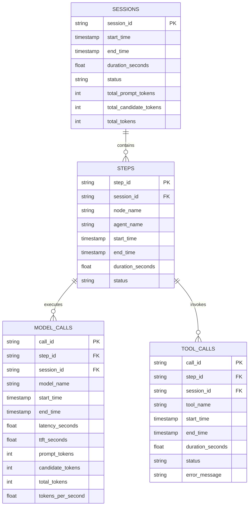

# Metrics & Telemetry Architecture

Coddy incorporates comprehensive execution, token usage, and latency telemetry backed by an embedded [**DuckDB**](https://duckdb.org/) database.

## 1. Storage Location & Schema

Telemetry data persists locally at:
```
~/.coddy/metrics.db
```

The database schema is initialized and managed by [`DuckDBService`](file:///Users/gpfister/Development/Projects/gpfister/coddy/coddy/app/coddy/utils/services/duckdb_service.py) with four core relational tables:



---

## 2. ADK Metrics Plugin (`MetricsPlugin`)

Defined in [`app/coddy/agentic/services/metrics_service.py`](file:///Users/gpfister/Development/Projects/gpfister/coddy/coddy/app/coddy/agentic/services/metrics_service.py), `MetricsPlugin` extends `google.adk.plugins.BasePlugin` and intercepts lifecycle hooks:

- `on_session_start` / `on_session_end`: Records total session boundaries and token rollups.
- `before_step` / `after_step`: Captures workflow graph node timings and status (`success`, `failed`).
- `before_agent` / `after_agent`: Associates agent names with executing nodes and updates `AgentExecutionView`.
- `before_model` / `after_model`: Measures latency, time-to-first-token (TTFT), prompt/candidate tokens, and throughput.
- `before_tool` / `after_tool`: Tracks tool arguments, execution duration, and potential exceptions.

---

## 3. CLI Inspection Commands

Coddy provides the `coddy metrics` subcommand suite:

### 3.1 `coddy metrics summary`
Displays aggregated model performance (latency, TTFT, tokens/sec) and recent session overviews:
```bash
coddy metrics summary
coddy metrics summary --session-id <SESSION_ID>
```

### 3.2 `coddy metrics sessions`
Lists individual sessions with execution start/end timestamps and token sums, or drills down into a specific session's step-by-step breakdown:
```bash
coddy metrics sessions --limit 15
coddy metrics sessions -s <SESSION_ID>
```

### 3.3 `coddy metrics tools`
Aggregates tool usage counts, cumulative execution duration, average latency, and failure counts:
```bash
coddy metrics tools
```
